<!--
  GitHub Profile README
  Repository: chaiyasit96/chaiyasit96
-->

<!-- ===== HERO BANNER ===== -->

  

  <h3>Building reliable backends. Designing scalable systems.</h3>

  

    
    <!--
      Add your real links, then uncomment:
      
      
    -->
  

---

## 👨‍💻 About Me

I'm a **Software Engineer focused on backend development, databases, and cloud infrastructure**.

I enjoy turning complex requirements into maintainable software, building reliable APIs, improving system performance, and designing architectures that scale.

- ⚙️ **Backend:** Node.js, TypeScript, Express, NestJS
- ☁️ **Cloud:** AWS, cloud-native applications, infrastructure
- 🗄️ **Data:** SQL, NoSQL, database design and optimization
- 🚀 **Engineering:** API performance, system design, clean and maintainable code
- 🧠 **Currently exploring:** AI engineering and modern backend architectures

I believe great software is built through continuous learning, thoughtful engineering, and attention to detail.

---

## 🛠️ Tech Stack

### Languages

  

### Backend & APIs

  

### Databases

  

### Cloud & DevOps

  

### Frontend & Development Tools

  

---

## 📊 GitHub Analytics

  

  

   

  

---

## 🌌 Contribution Journey

  <i>Every contribution is a step forward.</i>

### 📈 Activity Timeline

  

### 🐍 Contribution Snake

  <picture>
    <source media="(prefers-color-scheme: dark)" srcset="https://raw.githubusercontent.com/chaiyasit96/chaiyasit96/output/snake.svg" />
    <source media="(prefers-color-scheme: light)" srcset="https://raw.githubusercontent.com/chaiyasit96/chaiyasit96/output/snake-light.svg" />
    
  </picture>

  Learning, building, and improving — one project at a time.

  ### 💬 Let's Build Something Great

  *Keep learning. Keep building. Keep improving.*

  Thanks for visiting my profile! ⭐

